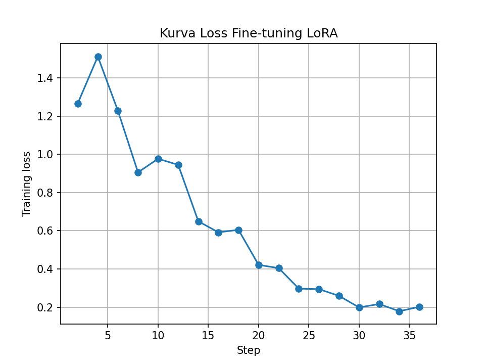
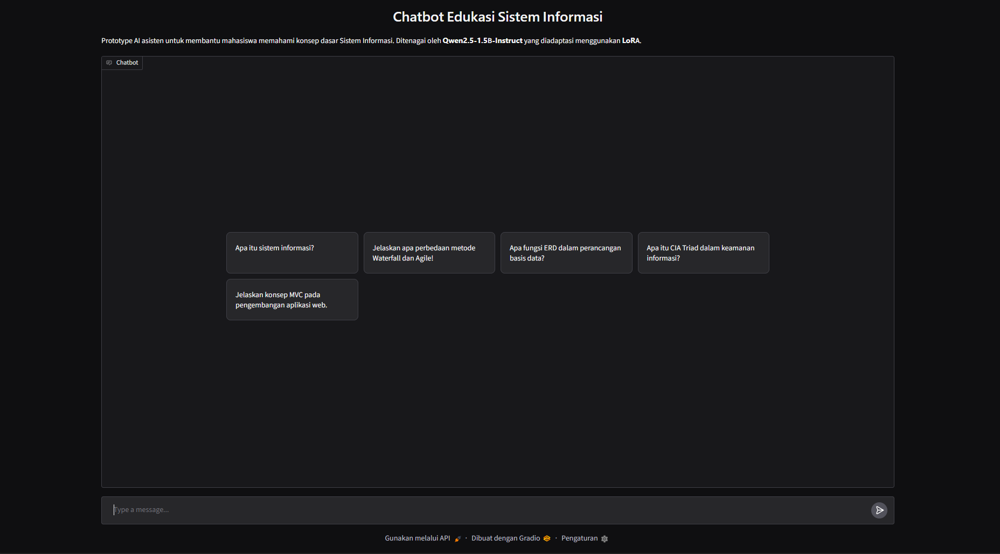

# 🎓 Chatbot Edukasi Sistem Informasi — Fine-Tuning Qwen2.5 dengan LoRA

Proyek Prototype AI untuk Ujian Tengah Semester (UTS) Mata Kuliah **Sistem Informasi Berbasis Kecerdasan Buatan**.

### 👥 Anggota Kelompok
1. **Muhammad Ushaim Mukmin Kasim** (NIM: 255150407111097)
2. **Abner Benedict Javier Siahaan** (NIM: 255150407111105)

---

## 📌 Ringkasan Masalah & Solusi
* **Permasalahan:** Mahasiswa pemula Sistem Informasi sering membutuhkan penjelasan konsep dasar (SDLC, Basis Data, Keamanan Sistem, Enterprise Systems) yang ringkas, akurat, dan langsung ke intinya. Model umum bawaan sering kali memberikan penjelasan yang terlalu panjang atau bertele-tele.
* **Solusi:** Membangun chatbot edukatif berbasis teks menggunakan **Qwen2.5-1.5B-Instruct** yang diadaptasi secara efisien menggunakan metode **LoRA (Low-Rank Adaptation)** dengan dataset instruksi spesifik domain Sistem Informasi.
* **Alur Aplikasi:** `Input Teks` ➡️ `Qwen2.5-1.5B + LoRA Adapter` ➡️ `Output Teks Ringkas & Terstruktur`

---

## ⚙️ Spesifikasi Model & Adaptasi LoRA

| Parameter / Komponen | Keterangan |
| :--- | :--- |
| **Base Model** | `Qwen/Qwen2.5-1.5B-Instruct` (FP16) |
| **Metode Adaptasi** | Parameter-Efficient Fine-Tuning (PEFT) via LoRA |
| **Konfigurasi LoRA** | Rank ($r$)=16, Alpha=32, Dropout=0.05 |
| **Target Modules** | `q_proj`, `k_proj`, `v_proj`, `o_proj`, `gate_proj`, `up_proj`, `down_proj` |
| **Training Hyperparameters** | Epoch=6, Batch Size=4, Grad Accum=2, LR=2e-4 (Cosine Scheduler) |
| **Platform Komputasi** | Google Colab (GPU Tesla T4 16GB VRAM) |

---

## 📊 Dataset & Preprocessing
* **Jumlah Data:** 52 pasangan instruksi dan respons konsep dasar Sistem Informasi (*handcrafted dataset*).
* **Pembagian Data:** 85% Data Latih (45 data) dan 15% Data Uji (7 data).
* **Prompt Masking:** Menggunakan token `label = -100` pada seluruh teks prompt dan pertanyaan, sehingga kalkulasi loss murni difokuskan pada token jawaban.

---

## 📈 Evaluasi: Baseline vs Fine-Tuned

Model dievaluasi secara objektif terhadap data uji (*test set*) menggunakan metrik **Token F1-Score** dan **Rata-rata Panjang Karakter/Kata**:

| Metrik Evaluasi | Model Baseline (Sebelum LoRA) | Model Fine-Tuned (Sesudah LoRA) |
| :--- | :---: | :---: |
| **F1 Token Overlap** | *(masukkan angka F1 base, misal: 0.38)* | *(masukkan angka F1 tuned, misal: 0.72)* |
| **Rata-rata Panjang Jawaban** | *(masukkan panjang base, misal: 68 kata)* | *(masukkan panjang tuned, misal: 35 kata)* |

### Analisis Hasil
1. **Gaya Bahasa & Relevansi:** Model fine-tuned terbukti mengadopsi format jawaban ringkas berstandar akademik dan tidak melantur (*verbose*).
2. **Kesesuaian Diksi Teknis:** Peningkatan skor F1 menunjukkan model mampu mereplikasi terminologi baku Sistem Informasi sesuai target domain.

*(Sisipkan gambar kurva loss di bawah)*

---

## 🖥️ Antarmuka Pengguna (Gradio)
Prototipe aplikasi diintegrasikan dengan antarmuka chat interaktif berbasis Gradio yang mendukung pengujian pertanyaan baru secara langsung.

*(Sisipkan screenshot UI Gradio)*

---

## 🚀 Cara Menjalankan Project

1. Buka file notebook `chatbot_edukasi_si.ipynb` di Google Colab.
2. Pastikan runtime diatur ke **T4 GPU** (`Runtime` ➡️ `Change runtime type` ➡️ `T4 GPU`).
3. Jalankan semua sel secara berurutan (`Runtime` ➡️ `Run all`).
4. Antarmuka Gradio akan aktif dan menyediakan tautan lokal serta tautan publik (`gradio.live`).
